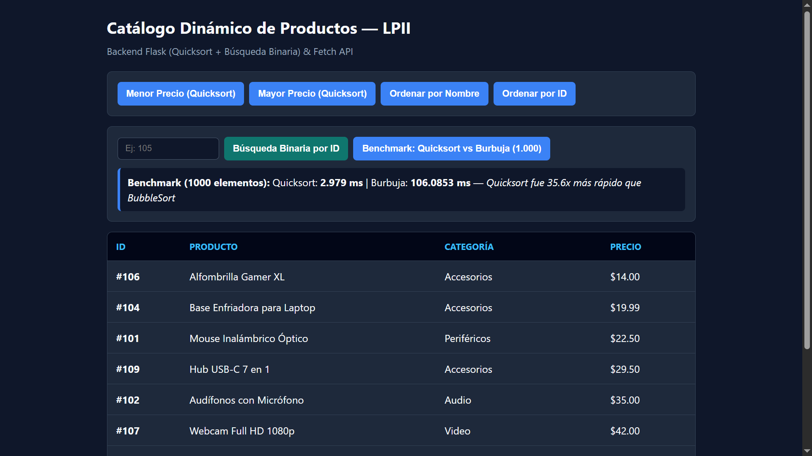

# Catálogo de Productos Desacoplado (Flask + Fetch API) — LPII
Aplicación web desacoplada desarrollada para **Lenguaje de Programación II**. 
Implementa un backend REST en **Flask** con algoritmos de ordenamiento 
(**Quicksort**), **Búsqueda Binaria** con precondición de ordenamiento y un 
**Benchmark** de rendimiento frente a Ordenamiento Burbuja (1.000 elementos).
## Estructura del Proyecto- `app.py`: Servidor Flask y algoritmos en Python.- `productos.json`: Catálogo base de productos.- `templates/index.html`: Interfaz web responsiva con HTML5, CSS y JS 
(`fetch()`).- `LICENSE`: Licencia de código abierto.
## Instalación y Ejecución Local
1. Clonar el repositorio y entrar a la carpeta del proyecto.
2. Crear entorno virtual: `python -m venv venv` y activarlo.
3. Instalar Flask: `pip install flask`
4. Ejecutar el servidor: `python app.py`
5. Abrir `http://127.0.0.1:5000` en el navegador.

## Despliegue: Vercel + Pinata/IPFS
- **App en producción:** https://catalogo-flask-lpii.vercel.app
- El backend Flask corre en Vercel y sirve la interfaz y los endpoints `/api/*`.
- El catálogo (`productos.json`) se obtiene desde Pinata/IPFS:
  - Gateway: `https://magenta-faithful-scallop-75.mypinata.cloud`
  - CID: `bafybeienrc6o2dcj7ny5efqpdqga3muzhgk3xe23ugwgxe3p4svm3dk6ta`
- Diagnóstico de la integración: `GET /api/pinata` (muestra la fuente activa: `pinata` o `local`).
- Si Pinata no responde en 3 segundos, la app usa automáticamente el `productos.json` local como respaldo.
- Se puede cambiar el gateway o el CID con las variables de entorno `PINATA_GATEWAY` y `PINATA_CID`.

## Captura de la interfaz
